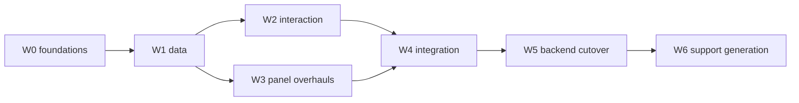

# GPUI full-port plan

The port's end state is DragonFruit's frontend running on GPUI, with the existing
Rust backend carried over and Tauri retired. This page is the working plan: the
waves, what each one owns, and the gates between them.

## End state

| Layer | Fate |
|---|---|
| React/Next.js frontend, three.js scene | replaced by `gpui/` (GPUI + wgpu) |
| Tauri shell and its 131 `#[tauri::command]`s | replaced by direct Rust calls |
| `rust/` backend crates (slicing engine, islands, mesh-core, mesh-repair, organic-cut, voxl-thumbnail) | carried over unchanged |
| Support generation (`src/supports` algorithms) | ported to Rust |
| Plugin system | separate port, out of scope here |

## Waves

Each wave ends with a single `cargo check`, build and `--smoke` run, a docs check
when docs moved, and one commit. Agents never run cargo themselves; that keeps a
wave's tree verifiable as a whole instead of piecemeal.

### W0 — foundations *(done)*

| Crate / change | Purpose |
|---|---|
| `gpui-voxl` | read the scene container: 16-byte header, 20-byte directory entries, zlib payloads, `MODL`/`MESH`/`SUPP`/`META` decode |
| `gpui-store` | persistence in `%APPDATA%\org.openresinalliance.dragonfruit`: `settings.json`, `session.json`, `support-presets.json`; atomic, debounced, versioned, corrupt-recovering |
| `gpui-locale` | the unit formatter ported from `src/utils/unitFormatting.ts`, a `t!` macro whose msgid is the English text, and a string extractor |
| `widgets/menu.rs` | flyouts, so the editor context menu can have `Repair ▸`, `Supports ▸`, `Geometry ▸` like `ContextMenu.tsx` |
| UI audit | a ranked list of already-ported UI that is wrong, which W3 executes |

### W1 — data *(done)*

VOXL through the load path (models, meshes, supports); `SUPP` into the instanced
support batches; the settings model in the store; a per-panel punch list.

### W2 — interaction *(in progress)*

The transform gizmo (`src/components/gizmo`: screen-space handles, move/rotate/
scale), the viewport's editor context menu (right-click distinguished from
orbit), and the support studio built against VOXL-loaded supports.

### W3 — panel overhauls

Every panel at design and behaviour parity, driven by the W0 audit rather than by
guesswork, split in two so the two agents own disjoint directories.

### W4 — integration

Printing preview, export, plate widgets, and a full-surface smoke pass.

### W5 — backend cutover

The 17.9k lines behind 131 Tauri commands become plain Rust: an `AppContext`
replacing `AppHandle`, background jobs for slicing/export/repair with progress in
the existing toasts, and printer discovery/USB/network ported from the Tauri
modules.

### W6 — support generation

Port in value order — placement (`autoSupport`, 10k lines), bracing (2.8k),
bezier shafts (2.2k), export geometry — each gated on **fixture parity**: the TS
generator emits a mesh plus the support records it produced, and the Rust port
must reproduce them within tolerance.

## Shipped so far

- **W0**: `gpui-voxl` reads a real scene (v2, 6 chunks, mesh, supports);
  `gpui-store` persists settings/session/presets atomically with debounce and a
  newer-schema guard; `gpui-locale` ports the unit formatter (verified against
  `Intl.NumberFormat`) with an English-literal msgid macro and a PO extractor;
  `widgets/menu.rs` gained flyouts.
- **W1**: VOXL through `load_path` (MESH payloads are binary STL, so they use the
  same refine/AO path as `.stl`); `SUPP` decoded into instanced support batches
  drawn one call per batch; the settings modal hydrates from the store and
  snapshots back; the session restores camera, tool, layout and last file; the
  support rail's tiles now mount their panels, including hollowing.

Known gaps after W1: `--smoke` cannot verify persistence because it calls
`std::process::exit`, which skips `Drop`; a VOXL model's X/Y rotation is dropped
(the viewport carries a Z angle only); support picking needs per-instance ids.

## Decisions

- **Persistence is ours, not interoperability.** Tauri's settings live in
  WebView2's `localStorage`, which the Rust process cannot read. The directory is
  shared because the *backend* already writes backups, plugin sideloads and the
  updater channel there. A one-time importer is a migration tool, not a feature.
- **i18n now, in English.** The unit formatter is the reason: 26 hardcoded
  decimal formats and 29 literal unit strings bake English into the UI, and
  `src/utils/unitFormatting.ts` exists precisely to prevent that. The catalog
  starts as msgid → msgid; translations land later without touching call sites.
- **Supports generation is ported, last.** The algorithms are ~17k lines of
  numeric TypeScript, not the 125k the directory holds — the rest is rendering we
  replace. Studio first, then placement, bracing, curves, export.
- **Gizmo is the screen-space one.** `TransformGizmo` + `ScreenSpaceGizmo`; the
  local-space variant waits until something needs it.

## Related

- [`gpui-crate-split.md`](gpui-crate-split.md) — crate and module layout.
- [`gpui-widgets.md`](gpui-widgets.md) — the widget library and its rules.
- [`gpui-voxl.md`](gpui-voxl.md), [`gpui-store.md`](gpui-store.md),
  [`gpui-locale.md`](gpui-locale.md) — the W0 crates.
